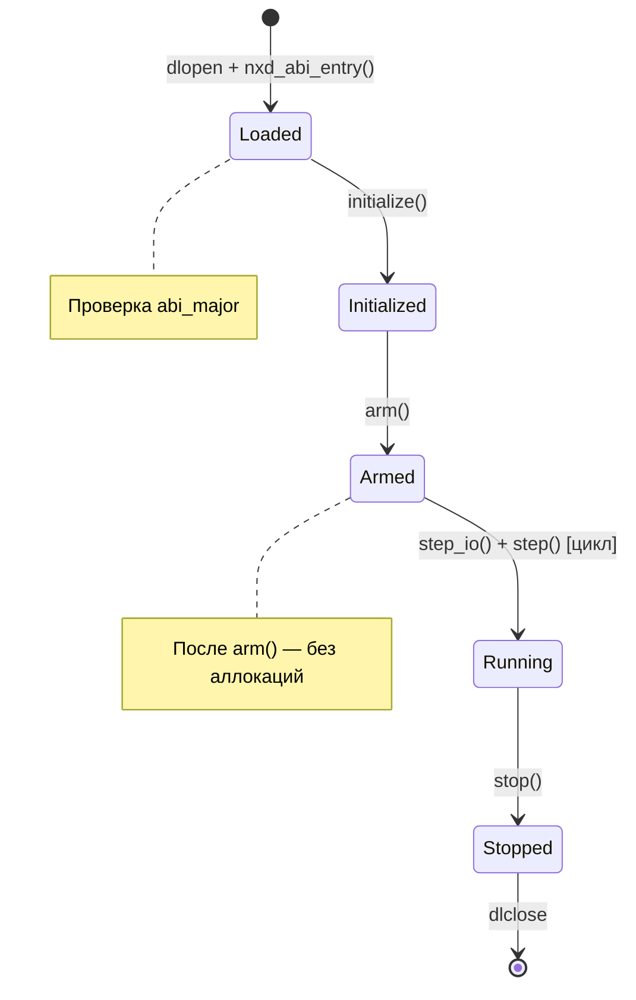
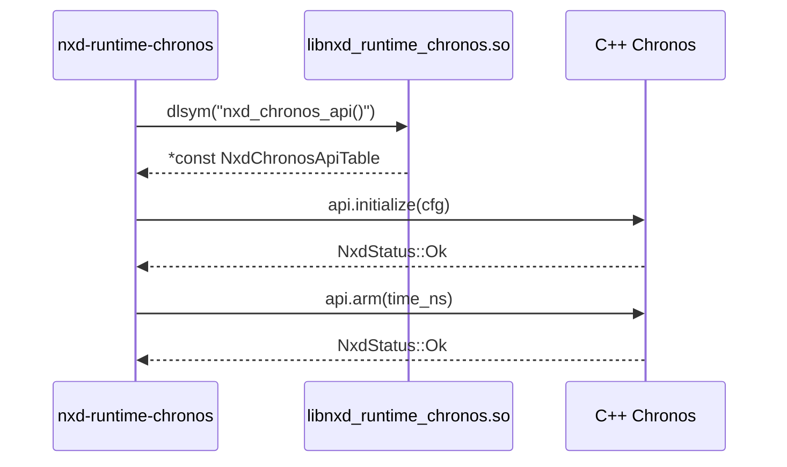

# Component Interop: Спецификация C++/Rust FFI

## Жизненный цикл плагина



## ABI-таблица

Каждый плагин экспортирует одну точку входа:

```c
// C (cbindgen-сгенерированный)
typedef struct NxdAbiTable {
    uint64_t                    abi_major;
    uint64_t                    abi_minor;
    NxdCreateFn                 create;
    NxdDestroyFn                destroy;
    NxdInitializeFn             initialize;
    NxdArmFn                    arm;
    NxdStepFn                   step;
    NxdStopFn                   stop;
    NxdStepIoFn                 step_io;
} NxdAbiTable;

extern const NxdAbiTable* nxd_abi_entry(void)
    __attribute__((visibility("default")));
```

Соответствующее объявление в Rust:

```rust
// sdk/rust/nxd-abi
#[repr(C)]
pub struct NxdAbiTable {
    pub abi_major: u64,
    pub abi_minor: u64,
    pub create: Option<unsafe extern "C" fn() -> *mut c_void>,
    pub destroy: Option<unsafe extern "C" fn(state: *mut c_void)>,
    pub initialize: Option<
        unsafe extern "C" fn(state: *mut c_void, config: NxdConfig) -> NxdStatus
    >,
    pub arm: Option<unsafe extern "C" fn(state: *mut c_void, time: NxdSimTime) -> NxdStatus>,
    pub step: Option<unsafe extern "C" fn(state: *mut c_void, time: NxdSimTime) -> NxdStatus>,
    pub stop: Option<unsafe extern "C" fn(state: *mut c_void)>,
    pub step_io: Option<unsafe extern "C" fn(state: *mut c_void, time: NxdSimTime) -> NxdStatus>,
}
```

## FFI-вызов от C++ к Rust (Chronos)



Сигнатура C API:

```cpp
extern "C" {
    typedef struct NxdChronosApiTable {
        NxdChronosHandle  (*create)(NxdChronosConfig config);
        void              (*destroy)(NxdChronosHandle handle);
        NxdStatus         (*initialize)(NxdChronosHandle handle);
        NxdStatus         (*arm)(NxdChronosHandle handle);
        NxdStatus         (*step)(NxdChronosHandle handle);
        void              (*stop)(NxdChronosHandle handle);
        int64_t           (*wall_time)(NxdChronosHandle handle);
        int64_t           (*hw_fpga_time)(NxdChronosHandle handle);
    } NxdChronosApiTable;

    const NxdChronosApiTable* nxd_chronos_api(void);
}
```

## Маппинг типов

| C/C++ | Rust | Примечание |
|-------|------|------------|
| `int64_t` | `i64` | Базовый тип симуляционного времени |
| `uint64_t` | `u64` | Счётчик фреймов |
| `NxdStatus` (int32_t) | `#[repr(i32)]` | Код возврата: Ok=0, Err=1, Fatal=2 |
| `NxdConfig*` | `*const NxdConfig` | Указатель на конфигурацию; время жизни — только на время вызова |
| `void*` | `*mut c_void` | Opaque handle состояния компонента |

## Обработка ошибок на границе FFI

```rust
#[repr(i32)]
pub enum NxdStatus {
    Ok = 0,
    Err = 1,
    Fatal = 2,
}

#[no_mangle]
pub unsafe extern "C" fn initialize(
    state: *mut c_void,
    config: *const NxdConfig,
) -> NxdStatus {
    let cfg = *config;  // безопасное копирование
    let state = unsafe { &mut *(state as *mut MyState) };
    match state.initialize(cfg) {
        Ok(()) => NxdStatus::Ok,
        Err(e) => {
            log::error!("initialize: {e}");
            NxdStatus::Err
        }
    }
}
```

## Риски на границе FFI

| Риск | Описание | Митигация |
|------|----------|-----------|
| Dangling pointer | C++ хранит `void*`; Rust может его инвалидировать | Все `*mut c_void` — opaque handle; время жизни через create/destroy |
| Layout mismatch | C++ struct и Rust `#[repr(C)]` не совпадают | cbindgen + статическая проверка sizeof() |
| Паника | Rust-паника при panic=abort убивает процесс | catch_unwind для всех точек входа |
| Глобальное состояние | Rust static mut небезопасно при перезагрузке | Запрещены static mut в SDK |