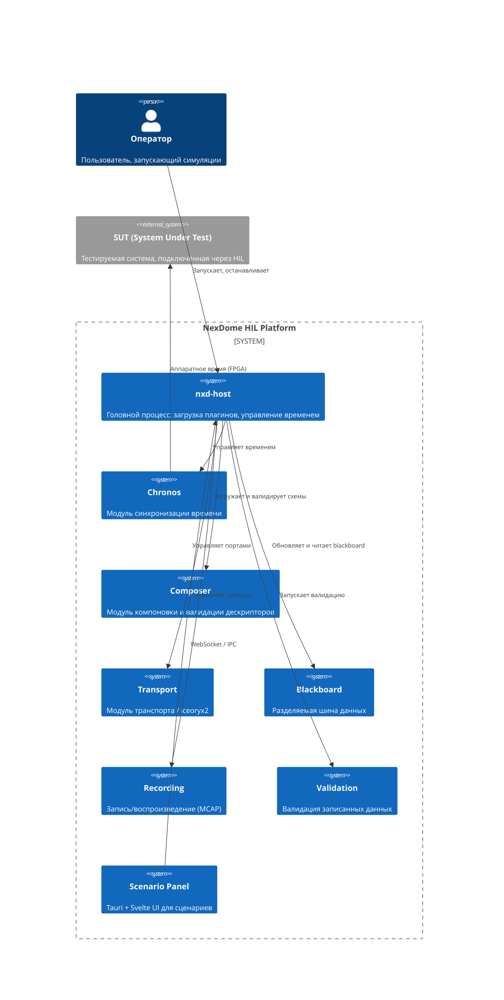
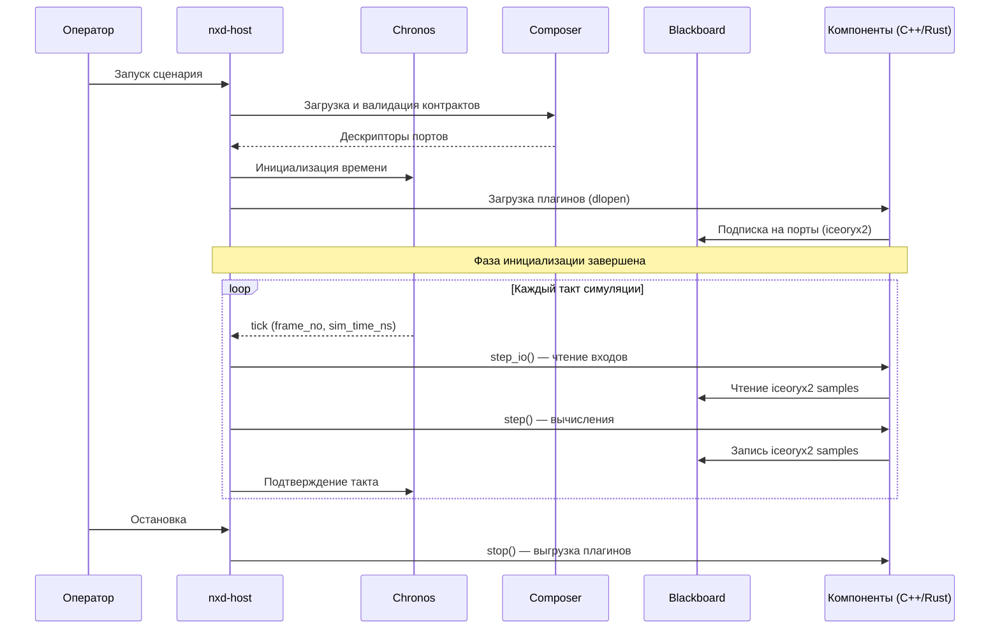

# System Overview: Общий ландшафт и контекст системы

## Контекст системы

## Поток данных

## Границы и зоны ответственности

| Зона | C++ | Rust |
|------|-----|------|
| **Runtime** | chronos, composer, transport, blackboard, recording, validation | `nxd-runtime-chronos` (Rust-обёртка над C API) |
| **SDK** | `sdk/cpp/` — C++ wrapper над cbindgen ABI | `nxd-abi` + `nxd-sdk` — безопасная обёртка |
| **Инструменты** | `nexigen-run`, `video-viewer` | `nxdc` (компилятор контрактов) |
| **Плагины** | Примеры: counter, virtual_can, video_opengl | Примеры: counter, scenario_control |
| **UI** | — | scenario-panel (Tauri + Svelte) |

## Риски и ограничения

| Риск | Описание | Митигация |
|------|----------|-----------|
| ABI-несовместимость | Плагин собран с другой версией SDK | Версионирование ABI через `abi_major`/`abi_minor` |
| Паника в Rust-плагине | `panic=abort` убивает весь процесс | Все Rust-компоненты используют `panic=abort` |
| Iceoryx2 deadlock | Неправильный порядок loan/write | Все публикации — через dedicated publisher per port |
| Layout mismatch | C++ struct vs `#[repr(C)]` Rust struct | `nxd_contracts` проверяет `sizeof()` на этапе сборки |