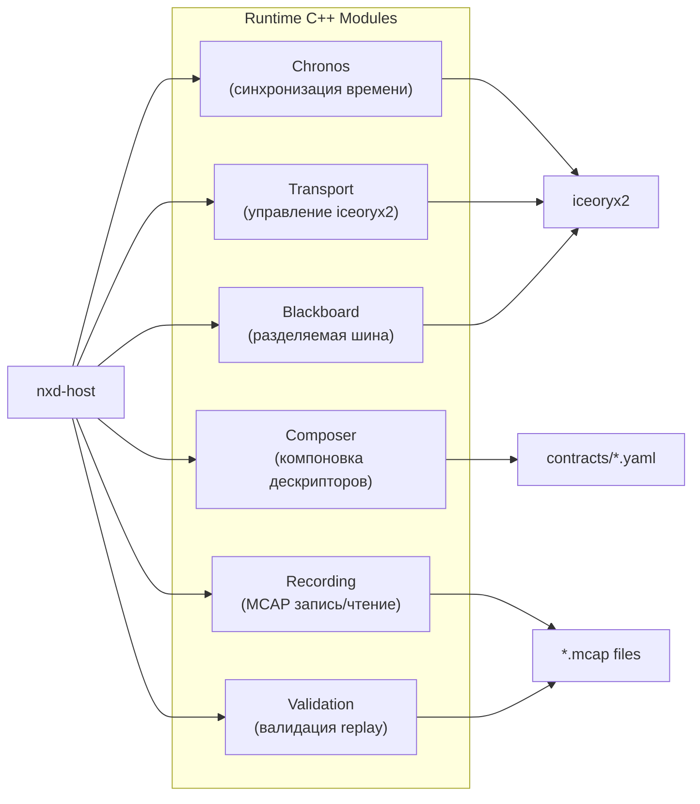
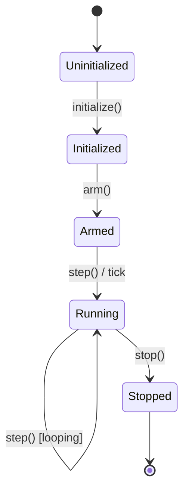

# C++ Modules: Спецификации runtime-модулей

## Взаимодействие модулей

## 1. Chronos — синхронизация времени

| Свойство | Значение |
|----------|----------|
| Директория | `runtime/chronos/` |
| Зависимости | iceoryx2, аппаратное время FPGA |
| Режимы времени | Wall time, HW FPGA time |
| Состояния | Uninitialized → Initialized → Armed → Running → Stopped |
| Детерминизм | Да, после arm() — без аллокаций |

**Ключевые файлы:**
- `state_machine.hpp` — конечный автомат
- `time.hpp` — типы времени (SimTime, WallTime, Duration)
- `partition.hpp` — разделение времени на интервалы
- `let_boundary.hpp` — границы Logical Execution Time
- `c_api.hpp` — C ABI для Rust-обёртки

## 2. Composer — компоновка дескрипторов

| Свойство | Значение |
|----------|----------|
| Директория | `runtime/composer/` |
| Назначение | Загрузка, валидация, проверка дескрипторов компонентов и контрактов |
| Вход | YAML-контракты + дескрипторы плагинов |
| Выход | Валидированные структуры для привязки портов |

## 3. Transport — управление iceoryx2

| Свойство | Значение |
|----------|----------|
| Директория | `runtime/transport/` |
| Назначение | Создание/удаление iceoryx2 сервисов, управление publisher/subscriber |
| Примитив | iceoryx2 Port — логический канал передачи данных |

## 4. Blackboard — разделяемая шина данных

| Свойство | Значение |
|----------|----------|
| Директория | `runtime/blackboard/` |
| Назначение | Разделяемая память между компонентами; zero-copy |
| Механизм | iceoryx2 shared memory segments, loaned samples |
| Операции | publish(), subscribe(), read_latest(), write() |

## 5. Recording — запись/воспроизведение (MCAP)

| Свойство | Значение |
|----------|----------|
| Директория | `runtime/recording/` |
| Формат | MCAP (ROS 2-совместимый) |
| Назначение | Запись всех портовых сообщений; воспроизведение для regression |

## 6. Validation — валидация записанных данных

| Свойство | Значение |
|----------|----------|
| Директория | `runtime/validation/` |
| Назначение | Сравнение replay с эталоном; обнаружение расхождений детерминизма |