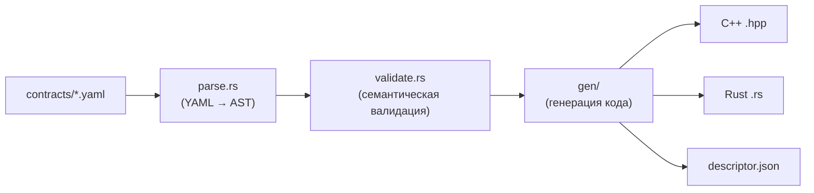

# Rust Crates: Спецификации Rust-крейтов

## Взаимодействие крейтов

```mermaid
flowchart TB
    subgraph Workspace["Rust Workspace"]
        NxdABI["nxd-abi\n(типы ABI, unsafe extern \"C\" fn)"]
        NxdSDK["nxd-sdk\n(безопасная обёртка)"]
        Nxdc["nxdc\n(компилятор контрактов)"]
        Chronos["nxd-runtime-chronos\n(Rust-обёртка C Chronos API)"]
    end
    
    NxdSDK --> NxdABI
    Nxdc --> serde_json
    Nxdc --> sha2
    Nxdc --> yaml_rust2
    Chronos --> CAPILib["libnxd_runtime_chronos.so"]
    Chronos --> NxdABI
```

## 1. nxd-abi

**Назначение:** Базовые ABI-типы для C++/Rust FFI. Все структуры — `#[repr(C)]`.

**Ключевые типы:**

```rust
#[repr(C)]
#[derive(Debug, Clone, Copy)]
pub struct NxdSimTime {
    pub sec: i64,
    pub nsec: i64,
}

#[repr(i32)]
pub enum NxdStatus { Ok = 0, Err = 1, Fatal = 2 }

#[repr(C)]
pub struct NxdAbiTable {
    pub abi_major: u64,
    pub abi_minor: u64,
    pub create: Option<unsafe extern "C" fn() -> *mut c_void>,
    pub destroy: Option<unsafe extern "C" fn(state: *mut c_void)>,
    pub initialize: Option<unsafe extern "C" fn(...) -> NxdStatus>,
    pub arm: Option<unsafe extern "C" fn(...) -> NxdStatus>,
    pub step: Option<unsafe extern "C" fn(...) -> NxdStatus>,
    pub stop: Option<unsafe extern "C" fn(state: *mut c_void)>,
    pub step_io: Option<unsafe extern "C" fn(...) -> NxdStatus>,
}
```

**Риск:** Все `unsafe extern "C" fn` — небезопасны. SDK гарантирует валидность через время жизни.

## 2. nxd-sdk

**Назначение:** Безопасная обёртка над nxd-abi. Предоставляет `NxdComponent` trait.

```rust
pub trait NxdComponent {
    type Config: DeserializeOwned;
    fn create(config: Self::Config) -> Result<Self, Error>;
    fn initialize(&mut self, sim_time: NxdSimTime) -> Result<(), Error>;
    fn arm(&mut self, sim_time: NxdSimTime) -> Result<(), Error>;
    fn step(&mut self, sim_time: NxdSimTime) -> Result<(), Error>;
    fn stop(&mut self);
}
```

**Макрос генерации entry points:**
```rust
#[macro_export]
macro_rules! nxd_component_entry {
    ($component:ty) => { /* extern "C" create/destroy/etc */ };
}
```

## 3. nxdc — компилятор контрактов

**Назначение:** Парсинг YAML → валидация → генерация C++/Rust кода.



| Файл | Назначение |
|------|------------|
| `src/parse.rs` | YAML-парсер с диагностикой |
| `src/validate.rs` | Семантическая валидация (CC после рефакторинга: <15) |
| `src/canonical.rs` | Хеширование layout для ABI-совместимости |
| `src/gen/cpp.rs` | Генератор C++ кода |
| `src/gen/rust.rs` | Генератор Rust кода |
| `src/gen/descriptor.rs` | Генератор JSON-дескрипторов |

## 4. nxd-runtime-chronos

**Назначение:** Rust-обёртка над C API Chronos.

```rust
pub struct ChronosHandle {
    inner: *mut c_void,
    api: &'static NxdChronosApiTable,
}

impl ChronosHandle {
    pub fn open() -> Result<Self, Error> {
        let lib = unsafe { Library::new("libnxd_runtime_chronos.so")? };
        let entry = unsafe {
            lib.get::<extern "C" fn() -> *const NxdChronosApiTable>(
                b"nxd_chronos_api\0"
            )?
        };
        let api = unsafe { &*entry() };
        let handle = unsafe { (api.create)(config) };
        Ok(Self { inner: handle, api })
    }
    
    pub fn wall_time(&self) -> NxdWallTime {
        unsafe { NxdWallTime::from_nanos((self.api.wall_time)(self.inner)) }
    }
}
```

**Риск:** `dlsym` + вызовы через таблицу — все unsafe.