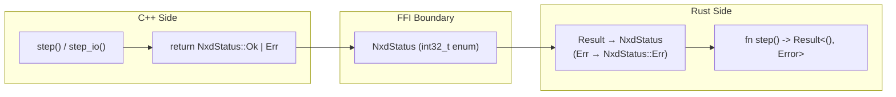
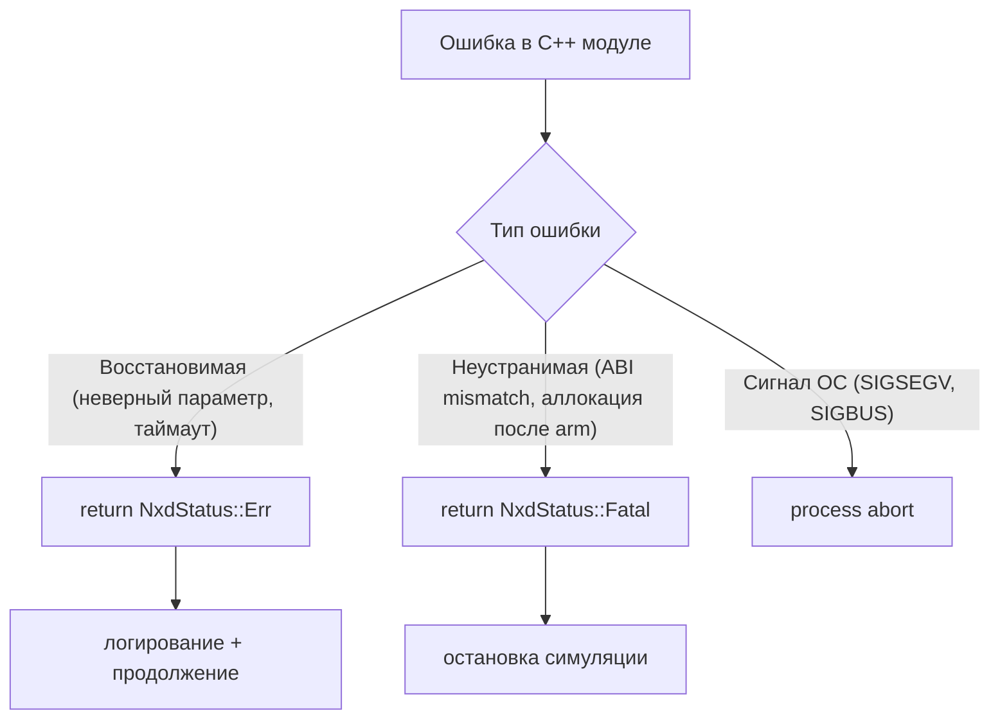
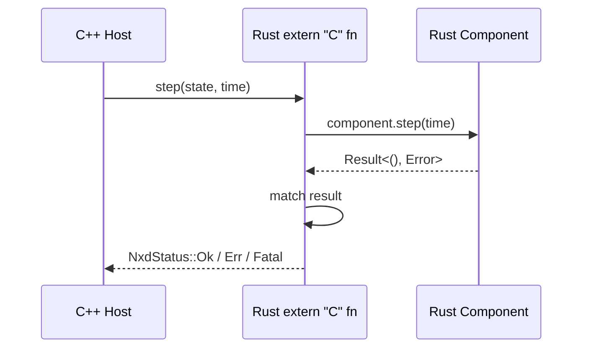
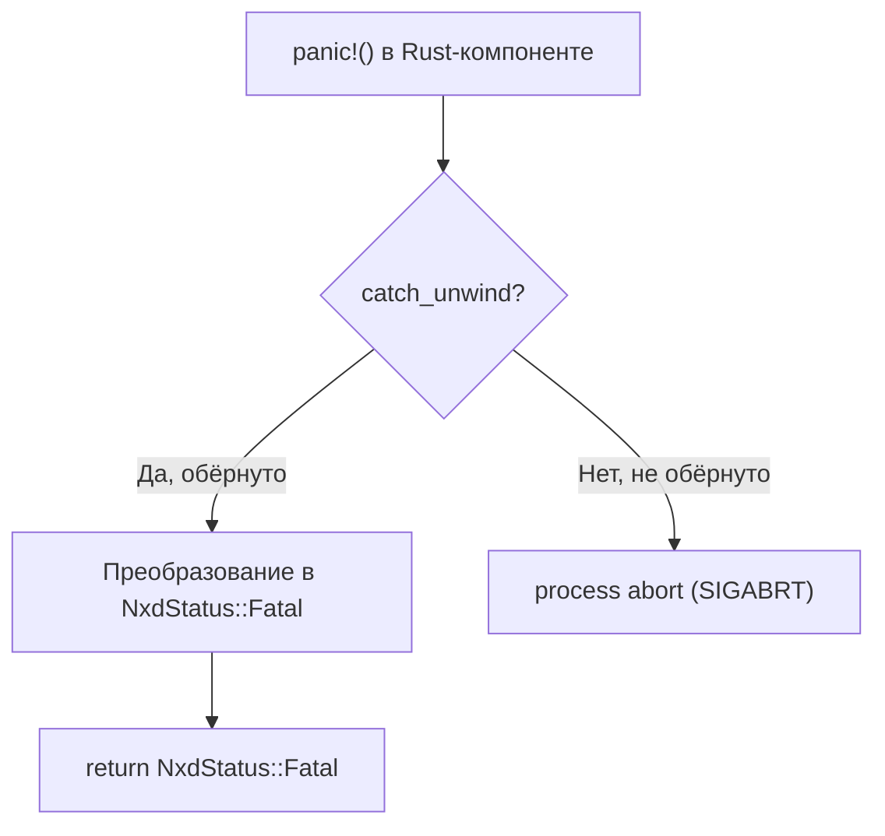

# Обработка ошибок: маппинг `Result<T,E>` ↔ коды возврата

## Навигация

| Раздел | Ссылка |
|--------|--------|
| [Концепция и дизайн](#концепция-и-дизайн) |
| [Единый код возврата NxdStatus](#единый-код-возврата-nxdstatus) |
| [C++ сторона: без исключений](#c-сторона-без-исключений) |
| [Rust сторона: Result<T, E> → NxdStatus](#rust-сторона-resultt-e--nxdstatus) |
| [Маппинг типов ошибок](#маппинг-типов-ошибок) |
| [Обработка паник](#обработка-паник) |
| [Диагностика и логирование](#диагностика-и-логирование) |
| [Таблица рисков](#таблица-рисков) |

---

## Концепция и дизайн

NexDome спроектирован с **нулевой толерантностью к необработанным исключениям** на hot path. После `arm()` ни C++, ни Rust не должны генерировать исключения или паниковать.



---

## Единый код возврата NxdStatus

Все FFI-функции возвращают `NxdStatus` — 32-битный enum с тремя значениями:

```c
// C/C++ объявление
enum NxdStatus : int32_t {
    Ok    = 0,   // Успех
    Err   = 1,   // Восстановимая ошибка (логируется, цикл продолжается)
    Fatal = 2,   // Неустранимая ошибка (цикл останавливается)
};
```

```rust
// Rust эквивалент (nxd-abi)
#[repr(i32)]
pub enum NxdStatus {
    Ok    = 0,
    Err   = 1,
    Fatal = 2,
}
```

---

## C++ сторона: без исключений

Проект компилируется с флагом `-fno-exceptions -fno-rtti`. Исключения C++ **запрещены** на всех уровнях.



Пример:

```cpp
// runtime/chronos/src/c_api.cpp
NxdStatus chronos_initialize(NxdChronosHandle handle) noexcept {
    auto* self = reinterpret_cast<Runtime*>(handle);
    
    if (self->state != State::Uninitialized) {
        // Логируем и возвращаем Err
        log::error("chronos: invalid state transition");
        return NxdStatus::Err;
    }
    
    self->state = State::Initialized;
    return NxdStatus::Ok;
}
```

---

## Rust сторона: `Result<T, E>` → `NxdStatus`

Каждая FFI-функция в Rust-плагине преобразует внутренний `Result<T, E>` в `NxdStatus` перед возвратом в C++.



Пример реализации:

```rust
// nxd-sdk: макрос генерации extern "C" entry point
// (упрощённая версия)
pub unsafe extern "C" fn step(
    state: *mut c_void,
    time: NxdSimTime,
) -> NxdStatus {
    // 1. Извлекаем состояние из opaque handle
    let component: &mut T = unsafe {
        &mut *(state as *mut Box<T>)
    };
    
    // 2. Вызываем пользовательскую логику — Result<(), Error>
    let result: Result<(), Error> = component.step(time);
    
    // 3. Маппим в NxdStatus
    match result {
        Ok(())   => NxdStatus::Ok,
        Err(_)   => {           // ← восстановимая
            log::error("step failed: {e}");
            NxdStatus::Err
        },
    }
}
```

---

## Маппинг типов ошибок

| Категория | C++ | Rust | NxdStatus | Действие |
|-----------|-----|------|:---------:|----------|
| ✅ Успех | — | — | `Ok` | Продолжение |
| ❌ Неверная конфигурация | проверка на границе | `Err(InvalidConfig)` | `Err` | Логировать, пропустить такт |
| ❌ Неверный переход состояния | `if (state != expected)` | `Err(InvalidTransition)` | `Err` | Логировать, пропустить такт |
| ❌ ABI mismatch | проверка `abi_major` | `Err(AbiMismatch)` | `Fatal` | Остановка, пересборка |
| ❌ Out of memory после arm() | `null` из `malloc` | — | `Fatal` | Остановка (не должно происходить) |
| ❌ Iceoryx2 failure | `null` из `loan_sample()` | — | `Err` | Пропустить публикацию |
| 💥 SIGSEGV/panic | сигнал ОС | `panic!()` | — | abort процесса |
| 💥 unwinding | — | `catch_unwind` → паника | `Fatal` | abort (panic=abort) |

---

## Обработка паник

Rust-компоненты компилируются с `panic=abort`. Это означает, что любая необработанная паника в Rust-коде **мгновенно завершает процесс**.



SDK предоставляет утилиту `catch_unwind` для безопасного вызова пользовательского кода:

```rust
// nxd-sdk: безопасный вызов step() с защитой от паники
pub unsafe extern "C" fn step_safe(
    state: *mut c_void,
    time: NxdSimTime,
) -> NxdStatus {
    // catch_unwind перехватывает панику и возвращает Result
    let result: Result<(), ()> = catch_unwind(|| -> NxdStatus {
        let component: &mut T = unsafe {
            &mut *(state as *mut Box<T>)
        };
        
        match component.step(time) {
            Ok(()) => NxdStatus::Ok,
            Err(e) => {
                log::error!("step: {e}");
                NxdStatus::Err
            },
        }
    });
    
    match result {
        Ok(status) => status,
        Err(())    => {
            log::error!("step: caught unwind (panic in component)");
            NxdStatus::Fatal  // паника эквивалентна Fatal
        },
    }
}
```

**Важно:** `catch_unwind` — **не панацея**. После паники состояние компонента может быть повреждено. SDL всегда вызывает `destroy` после `Fatal`, чтобы освободить ресурсы.

---

## Диагностика и логирование

NexDome использует структурированное логирование с единым форматом:

```cpp
// C++: логирование через nxdc-диагностику или собственный логер
if (result != Ok) {
    log::error("chronos::step: {frame_no}: {error_code}");
}
```

```rust
// Rust: логирование через std::log
match result {
    Err(e) => {
        log::error!("component::step: frame {frame_no}: {e}");
        // e может содержать трассировку (SpanTrace)
    }
}
```

**Структура диагностического сообщения:**

```
[YYYY-MM-DD HH:MM:SS.xxx] {level} {module} {frame_no}: {message} [{path}:{line}]
```

Где:
- `level`: `INFO`, `WARN`, `ERROR`, `FATAL`
- `module`: `chronos`, `composer`, `blackboard`, или имя компонента
- `frame_no`: номер фрейма симуляции (0 для внешних событий)
- `path`, `line`: исходный файл и номер строки (только в debug)

---

## Таблица рисков

| № | Риск | Описание | Вероятность | Влияние | Митигация |
|:-:|------|----------|:-----------:|:-------:|-----------|
| 1 | **Необработанная паника Rust** | `panic!()` без `catch_unwind` убивает процесс | Низкая | Высокое (потеря всех данных сессии) | SDK оборачивает все точки входа в `catch_unwind` |
| 2 | **Исключение C++ на hot path** | `-fno-exceptions` отключено в пользовательском плагине | Низкая | Высокое (SIGABRT) | CI проверяет флаги компиляции плагинов |
| 3 | **Fatal игнорируется** | C++ хост продолжает цикл после получения `Fatal` | Средняя | Высокое (каскад ошибок) | Хост останавливает симуляцию после `Fatal` |
| 4 | **Err маскирует Fatal** | Rust преобразует `Fatal`-подобную ошибку в `Err` | Средняя | Среднее (неопределённое поведение) | Code review; clippy-правило для маппинга |
| 5 | **Потеря диагностики** | C++ не читает логи до abort | Низкая | Среднее (сложно диагностировать) | Журналирование через mmap-файл, flush перед abort |
| 6 | **Undefined Behavior в Result** | Rust использует `unwrap()` на `Result::Err` — паника | Средняя | Высокое | CI запускается с `-Wclippy::unwrap`; `?` оператор обязателен |