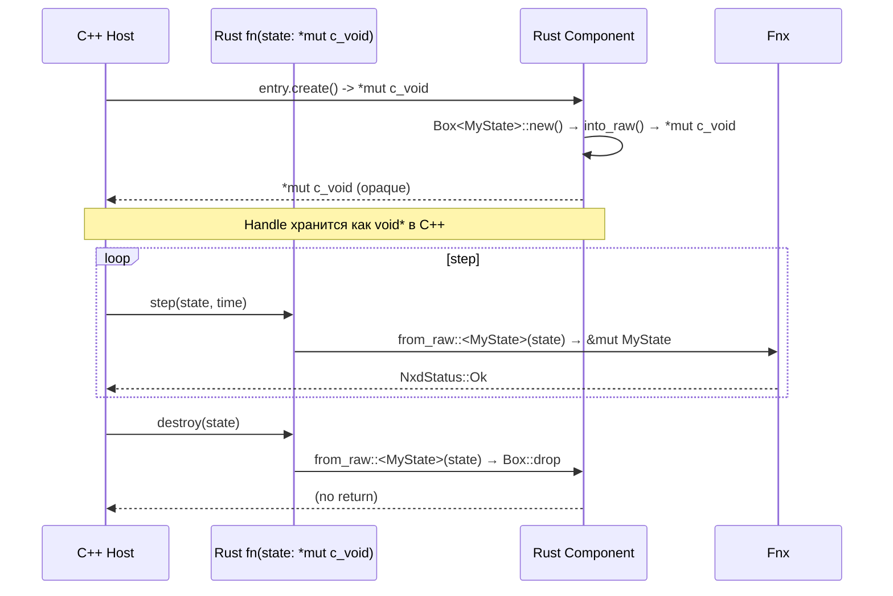
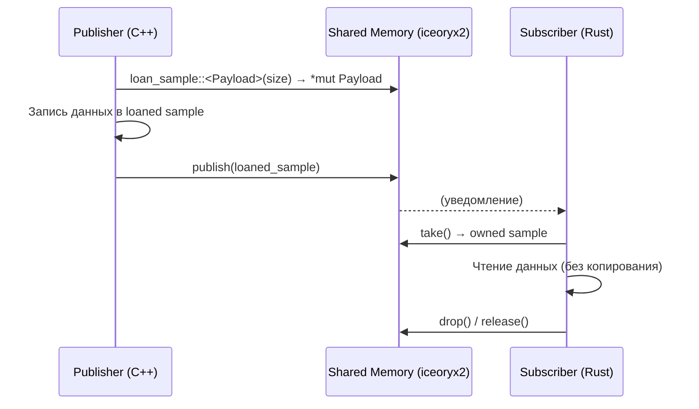

# Управление памятью: RAII vs Borrow Checker, аллокация на границе FFI

## Навигация

| Раздел | Ссылка |
|--------|--------|
| [Концепция и парадигмы](#концепция-и-парадигмы) |
| [Жизненный цикл opaque handle](#жизненный-цикл-opaque-handle) |
| [Аллокация до arm() vs после arm()](#аллокация-до-arm-vs-после-arm) |
| [Iceoryx2: loaned samples и zero-copy](#iceoryx2-loaned-samples-и-zero-copy) |
| [Граница FFI: C++ → Rust](#граница-ffi-c--rust) |
| [Граница FFI: Rust → C++](#граница-ffi-rust--c) |
| [Таблица рисков](#таблица-рисков) |

---

## Концепция и парадигмы

NexDome использует две принципиально разные модели управления памятью на разных сторонах FFI-границы:

| Модель | C++ | Rust |
|--------|-----|------|
| **Базовый механизм** | RAII (конструктор/деструктор) | Borrow Checker (владение + заимствование) |
| **Время жизни ресурса** | Явное: `new`/`delete`, `malloc`/`free`, or автоматическое через стек/`std::unique_ptr<>` | Неявное через скоуп; явное через `Box::into_raw`/`Box::from_raw` на границе FFI |
| **Аллокация** | `malloc` или `new` для кучи, `alloca` запрещена | `Box::new()`, `Vec::with_capacity()`, `HashMap::new()` |
| **Zero-copy** | iceoryx2 loaned samples (разделяемая память) | iceoryx2 loaned samples через Rust SDK |
| **После `arm()`** | `malloc` запрещён | `Box::new()` запрещён |

---

## Жизненный цикл opaque handle

Единственный способ безопасно передать состояние между C++ и Rust — opaque handle (`*mut c_void` / `void*`).



**Правила времени жизни:**
1. C++ никогда не интерпретирует содержимое `void*` — handle непрозрачен.
2. Rust SDK обеспечивает, что `Box::from_raw` вызывается ровно один раз (в `destroy`).
3. После `destroy` handle считается инвалидированным; повторный вызов — UB.

Реализация паттерна в Rust SDK:

```rust
// sdk/rust/nxd-sdk — безопасное создание opaque handle
fn create_handle<T: NxdComponent>(
    component: T,
) -> *mut c_void {
    let box: Box<T> = Box::new(component);
    // into_raw передаёт владение C++ без drop
    Box::into_raw(box)      // → *mut c_void
}

fn destroy_handle<T: NxdComponent>(
    raw: *mut c_void,
) {
    if raw.is_null() { return; }
    // from_raw возвращает владение Rust, Box::drop при выходе из скоупа
    let _ = Box::from_raw::<T>(raw);
} // ← здесь drop
```

---

## Аллокация до arm() vs после arm()

Платформа разделяет жизненный цикл на две фазы с разными требованиями к аллокации:

```mermaid
flowchart LR
    subgraph ColdPath["Холодный путь (до arm())"]
        Init["initialize()\n✅ malloc разрешён\n✅ Box::new разрешён\n✅ Vec::push разрешён"]
    end
    subgraph HotPath["Горячий путь (после arm())"]
        Step["step() / step_io()\n❌ malloc запрещён\n❌ Box::new запрещён\n❌ Vec::push запрещён\n✅ Только pre-allocated буферы"]
    end
    
    Init -->|arm()| Step
```

| Операция | В `initialize()` | В `step()` |
|----------|:----------------:|:----------:|
| `malloc` | ✅ Разрешено | ❌ Запрещено |
| `Box::new()` | ✅ Разрешено | ❌ Запрещено (Rust) |
| `Vec::push()` | ✅ Разрешено | ❌ Запрещено |
| `HashMap::insert()` | ✅ Разрешено | ❌ Запрещено |
| Запись в pre-allocated массив | — | ✅ Разрешено |
| Iceoryx2 `loan_sample()` | ✅ Разрешено | ✅ Разрешено (не аллоцирует) |
| `std::unique_ptr::make()` | ✅ Разрешено | ❌ Запрещено |

**Почему?** После `arm()` система переходит в детерминированный режим реального времени. Любая аллокация может:
- Вызвать задержку GC (неактуально — GC нет)
- Фрагментировать кучу
- Привести к page fault при расширении хипа ОС
- Нарушить LET (Logical Execution Time) гарантии

---

## Iceoryx2: loaned samples и zero-copy



**Ключевое свойство:** iceoryx2 не копирует данные между publisher и subscriber. Вместо этого:
1. Publisher запрашивает участок разделяемой памяти ("loan").
2. Записывает данные напрямую в shared memory segment.
3. После `publish()` владение переходит к iceoryx2.
4. Subscriber получает ссылку на тот же участок памяти.
5. После `drop()` память возвращается в пул.

**Влияние на модель памяти:**
- C++: `loan_sample::<Payload>(size)` возвращает сырой `void*`, который кастуется к `Payload*`.
- Rust: `loan_sample::<Payload>(size)` возвращает `*mut Payload` — требуется `unsafe { ... }`.
- Никаких копирований на hot path. Запись в loaned sample идёт напрямую в разделяемую память.

---

## Граница FFI: C++ → Rust

При вызове из C++ в Rust (C++ хост вызывает Rust-плагин через `extern "C"`):

| Аспект | Правило |
|--------|---------|
| **Аргументы-ссылки** | Rust получает `*mut` или `*const`. Должен считать, что они валидны только во время вызова. |
| **Возврат указателя** | Rust может вернуть `*mut c_void` (opaque handle). C++ не должен его интерпретировать. |
| **Владение строкой** | Строки передаются как `*const char` + `usize` (длина). Rust должен скопировать, если нужна собственная строка. |
| **Структуры** | Все структуры на границе — `#[repr(C)]` с явным выравниванием. Copy, clone, no heap interior pointers. |

Пример передачи конфигурации:

```c
// C++ (вызывающая сторона)
struct NxdConfig {
    int64_t sim_time_sec;
    int64_t sim_time_nsec;
    uint64_t frame_no;
    int32_t padding;  // явное выравнивание до 8 байт
};

extern NxdStatus initialize(void* state, const NxdConfig* config);
```

```rust
// Rust (принимающая сторона)
#[repr(C)]
#[derive(Debug, Clone, Copy)]
pub struct NxdConfig {    
    pub sim_time_sec: i64,
    pub sim_time_nsec: i64,
    pub frame_no: u64,
    _padding: i32,      // явное выравнивание
}

#[no_mangle]
pub unsafe extern "C" fn initialize(
    state: *mut c_void,
    config: *const NxdConfig,
) -> NxdStatus {
    // config — временный: копируем сразу
    let cfg: NxdConfig = *config;   // безопасное копирование
    let state = unsafe { &mut *(state as *mut MyState) };
    // ... используем cfg (owned copy)
}
```

---

## Граница FFI: Rust → C++

При вызове из Rust в C++ (Rust SDK вызывает C++ Chronos через таблицу):

| Аспект | Правило |
|--------|---------|
| **Загрузка C библиотеки** | `Library::new("libnxd_chronos.so")` — `unsafe`, требует `dlsym`. |
| **Точка входа** | Таблица функций: `*const NxdChronosApiTable` — загружается один раз при инициализации. |
| **Вызов** | Каждый вызов — через `unsafe { (api.wall_time)(handle) }`. |
| **Передача handle** | `*mut c_void` — C++ интерпретирует как `this`-подобный указатель на внутреннее состояние. |

```rust
// Rust: безопасная обёртка над C таблицей
impl ChronosHandle {
    pub fn wall_time(&self) -> NxdWallTime {
        unsafe {
            // self.inner — opaque handle, C++ знает его тип
            let ns = (self.api.wall_time)(self.inner);
            NxdWallTime::from_nanos(ns)
        }
    }
}
```

Время жизни `self.inner` синхронизировано с временем жизни `ChronosHandle`:

```rust
impl Drop for ChronosHandle {
    fn drop(&mut self) {
        unsafe {
            // C++ destroy — последний вызов
            (self.api.destroy)(self.inner);
        }
        // C++ сторона может инвалидировать self.inner
    }
}
```

---

## Таблица рисков

| № | Риск | Описание | Вероятность | Влияние | Митигация |
|:-:|------|----------|:-----------:|:-------:|-----------|
| 1 | **Dangling handle** | C++ продолжает использовать `void*` после `destroy` | Низкая | Высокое (SIGSEGV) | C++ обнуляет handle в своей таблице после destroy |
| 2 | **Double drop** | Rust SDK вызывает `Box::from_raw` дважды на одном указателе | Средняя | Высокое (double free, SIGSEGV) | Проверка `is_null()` перед `from_raw`; гарантия single-call через контракт |
| 3 | **Аллокация после arm()** | Rust-компонент вызывает `Box::new()` в `step()` | Средняя | Среднее (нарушение LET) | Проверка на CI через линтер; clippy-правило |
| 4 | **Layout mismatch** | C++ struct с другим выравниванием, чем `#[repr(C)]` | Низкая | Высокое (data corruption) | cbindgen — единый источник; `sizeof`-проверки в тестах |
| 5 | **Iceoryx2 use-after-free** | Rust удерживает ссылку на loaned sample после `drop()` | Низкая | Высокое (data race) | loaned sample — RAII/ Drop; после `drop()` ссылка невалидна |
| 6 | **Переполнение стека** | Глубокая рекурсия на hot path | Низкая | Высокое (SIGSEGV) | Рекурсия запрещена после `arm()` |
| 7 | **FFI строка без копирования** | Rust сохраняет `*const char` для использования после возврата из FFI | Низкая | Среднее (чтение мусора) | SDK копирует все строки при получении |