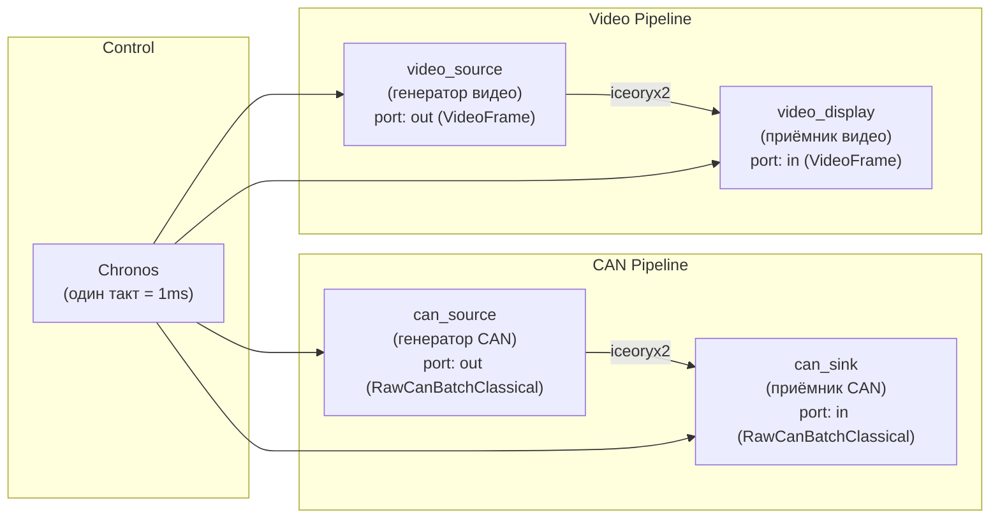

# CAN Source + Sink / Video Source + Display — NexDome Demo

Это демонстрация двух полных конвейеров данных через iceoryx2:

1. **CAN pipeline**: `can_source` → iceoryx2 → `can_sink`
2. **Video pipeline**: `video_source` → iceoryx2 → `video_display`

## Структура

```
components/can_source/component.yaml       # Дескриптор CAN источника
components/can_sink/component.yaml         # Дескриптор CAN приёмника
components/video_source/component.yaml     # Дескриптор видео источника
components/video_display/component.yaml    # Дескриптор видео приёмника

examples/components/cpp/can_source/can_source.cpp
examples/components/cpp/can_sink/can_sink.cpp
examples/components/cpp/video_source/video_source.cpp
examples/components/cpp/video_display/video_display.cpp

plans/can_video_demo.json                  # Dome Plan, соединяющий всё
```

## Сборка

```bash
# 1. Сгенерировать дескрипторы
cmake -S . -B build
cargo run -q -p nxdc -- emit-component-descriptor \
    components/can_source/component.yaml \
    build/generated/descriptors/can_source.descriptor.json

cargo run -q -p nxdc -- emit-component-descriptor \
    components/can_sink/component.yaml \
    build/generated/descriptors/can_sink.descriptor.json

cargo run -q -p nxdc -- emit-component-descriptor \
    components/video_source/component.yaml \
    build/generated/descriptors/video_source.descriptor.json

cargo run -q -p nxdc -- emit-component-descriptor \
    components/video_display/component.yaml \
    build/generated/descriptors/video_display.descriptor.json

# 2. Собрать компоненты
cmake --build build -j$(nproc)

# 3. Запустить демо
./build/tools/nexigen-run/nexigen-run plans/can_video_demo.json
```

## Ожидаемый вывод

```
[can_source]  frame=0000: publishing 3 CAN frames (0x100, 0x200, 0x300)
[can_sink]    frame=0000: received 3 CAN frames
  CAN ID=0x100 dlc=4 payload=[0xDE 0xAD 0xBE 0xEF]
  CAN ID=0x200 dlc=2 payload=[0xCA 0xFE]
  CAN ID=0x300 dlc=8 payload=[0x01 0x02 0x03 0x04 0x05 0x06 0x07 0x08]
[video_source] frame=0020: publishing video 1920x1080 RGBA seq=0
[video_display] frame=0020: received video 1920x1080 RGBA seq=0 checksum=0xA3B2C1D0
[can_source]  frame=1000: publishing 2 CAN frames (0x100, 0x400)
[can_sink]    frame=1000: received 2 CAN frames
...
```

## Архитектура

